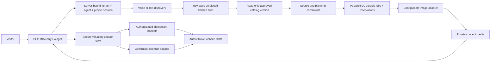

# MIA target architecture
Status: recommended Phase 1 design, subject to contract review. No new production service is provisioned.

## Ownership
| Component | Owner |
|---|---|
| Session/profile/voice/text/tools, planning revisions/jobs/media, runtime audits | KI-LIVE-VOICE-AGENTS |
| PHP public entry, CRM intake/database/UI/customer history, confirmed appointment projection | mein-kuechenexperte |
| Calendar provider operations | Explicit approved adapter/calendar binding; not inherited from Anna |
| Manufacturer catalog versions | Existing local CARAT catalog core/schema located; proposed neutral service/MIA consumer; readiness incomplete |
| Dealer assortment/conditions, customer/project data | Each tenant independently |
| CARAT professional import | Future verified vendor adapter; not current runtime capability |

### Flow

## Identity and dispatch
Introduce a shared public-agent resolver across widget config, text/WebSocket, voice SDP/secret, uploads, costs, contact and booking. Unknown explicit agent fails closed; omitted agent preserves KEA compatibility for existing entry points.
Persist immutable tenant_id + agent_id + session_id + project_id ownership. Prefer indexed agent_id on Conversation with additive migration/backfill to known current agents; do not infer ambiguous historical ownership. One owner edits identity schema/core files.
Browser labels and visitor UUIDs do not authorize access. Anonymous session uses scoped capability; opt-in later resume needs proof, expiry, rotation/revocation and cross-origin cookie/token-exchange design.
A single widget shell with explicit instance/agent identity must replace assumptions of one hardcoded root before adding independent entry points.

## Planning state
Authoritative KitchenConcept holds geometry, openings/connections, preferences, budget intent, materials, components/appliances, source references and assumptions. Each measurement includes evidence status and provenance.
Unknown dimensions remain null. Illustrative render_scene dimensions are separate assumed data; pixels cannot upgrade them to verified geometry.
Immutable version snapshots and allowlisted semantic patches use optimistic concurrency. Exactly one successful revision per accepted request. No silent mutation of earlier catalog/source/revision evidence.
Changed geometry invalidates dependent checks. Structured unchanged values can be byte-identical; generated visual preservation requires evaluation and honest drift disclosure.

## Durable jobs and media
Reuse existing PostgreSQL and private filesystem where approved. No Redis/new server/new permanent DB engine is justified.
Persist jobs, attempts, leases, reservations and usage. A bounded worker claims with row locking/lease, supports heartbeat, restart recovery and outbox. API returns 202 + job state, not a synchronous long-running request.
Ambiguous paid-call result becomes outcome_unknown: reconcile rather than automatically redispatch. Cancel stops further dispatch/publication; provider cancellation/refund is not guaranteed.
Generate/edit behind a provider adapter with configurable model/pricing snapshot. Benchmark current official Image API candidates before selection; do not hardcode model claims or prices.
Media remain outside web roots, bound to tenant/agent/project/revision, with checksum, expiry and protected access. CRM stores durable opaque refs, never a permanently public or expired signed URL.

## Central manufacturer catalog proposal
User proposes one update surface shared by projects/tenants. Recommended separation:
1. Neutral supplier source revisions and catalog-series versions, immutable provenance and validation gates.
2. Scoped read-only catalog API with explicit consumer entitlements.
3. Tenant-local overlays for authorized assortment, local prices/discounts/conditions, branding and planning policies.
4. Tenant-local projects/customer data. No DKH-to-MKE CRM or memory link.
A shared catalog cannot live as implicitly accessible DKH tenant data. The discovered local catalog_knowledge schema is already supplier/series/version based, without tenant/customer/project entities; its operation and package are still CARAT-owned. Extracting/migrating its classified scope requires an independently reviewed change and consumer access contract. Reuse existing core/evidence without duplicate imports if safe; a new physical database/server is not assumed.
Identity includes supplier, catalog code, assortment, handle system, market and language; version includes edition/source SHA256. Keep GL and XL separate. Consumers pin an exact certified version; central updates do not retroactively alter existing plans.
No shared promotion of tenant memory is implied. Actual local catalog location and exact GL/XL hashes are established; no active business-ready version or MIA consumer exists. See [catalog reuse assessment](CATALOG_REUSE_ASSESSMENT.md). A server copy has not been verified.

## CRM and calendar
Resolve current CRM authority before routing. Existing legacy website ledger and running new CRM are distinct; avoid blind dual writes.
Use versioned limited service intake, atomic event uniqueness and outbox acknowledgment; CRM derives its business records itself.
Anna-only tools remain Anna-only. Reuse calendar mechanics through a distinct MIA actor/provider/calendar grant and action-specific consent. Secure form contact reference precedes booking; no arbitrary client email or calendar ID.
Voice extraction/tool execution needs server-observed validated events; browser-origin transcript alone is not authoritative for writes.

## Provider-neutral export
Export conceptual JSON, brief, provenance, validations/unknowns and protected media manifest. It is planning-handoff preparation. No current CARAT API/license/import is verified.

## Decision status
See DECISIONS.md. Contract review and owner decisions precede independent implementation of shared interfaces.
